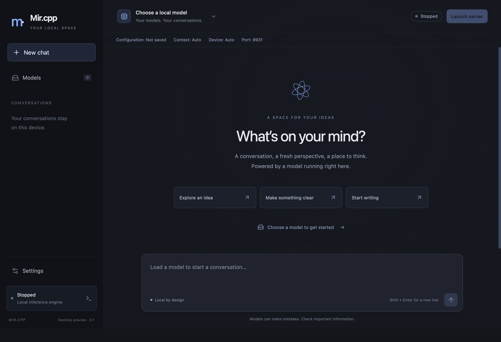
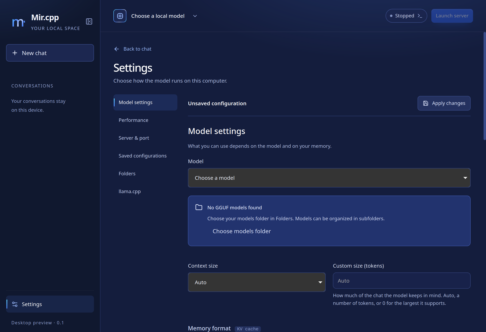

<p align="center">
  
</p>

# Mir.cpp

Chat with local GGUF models in a desktop app. Mir.cpp manages llama.cpp,
your model settings and conversations on your computer.

Mir.cpp is written for humans to read, maintain, and improve.

This development branch introduces the desktop interface. The published stable
release is still **v1.0.0**, which uses terminal menus and browser chat.
To try this branch's desktop, run `bash mir/mir.sh` from its checkout.

Mir.cpp targets Linux and macOS. llama.cpp supplies CPU and accelerator support;
packaged backends are pinned to a selected upstream release. External builds remain
selectable. Earlier hardware checks apply to their recorded configurations.

[](mir/docs/screenshots/desktop-chat.png)

*Choose a model and chat locally. This first-launch screen shows no inference.*

## Requirements

- A graphical Linux session or macOS 13.5 or newer.
- For source preparation: Bash, curl, working HTTPS certificates and network access.
- For source preparation on macOS, an existing [Homebrew](https://brew.sh/) installation.
- For chat, a GGUF supported by your llama.cpp build and enough hardware memory.

Source startup prepares the desktop automatically. The running desktop uses native
Rust services and does not require Bash or Python. Missing system packages require your
consent; assisted installation supports Ubuntu/Debian and existing Homebrew setups.
Model files and GPU drivers are separate requirements. Building llama.cpp on macOS
also requires Apple's command line tools. See the
[official llama.cpp build instructions](https://github.com/ggml-org/llama.cpp/blob/master/docs/build.md).

## Stable installation

```bash
curl -fsSL https://raw.githubusercontent.com/etufarini/Mir.cpp/v1.0.0/mir/sh/install.sh | bash
mir
```

This installs the published **v1.0.0 terminal edition** for your user in
`~/.local/share/mir.cpp/` and creates `~/.local/bin/mir`. The desktop changes in
this branch have not been published. Existing profiles remain compatible.

## Desktop first launch

```bash
bash mir/mir.sh
```

1. Open **Settings → llama.cpp** to review the bundled backend or choose an external
   build. Source builds without a bundled backend need an existing llama.cpp folder.
2. Choose your **Models folder** in **Folders**. Subfolders are searched too.
3. Choose a model in **Model settings**, review its settings and launch the server.
4. Optionally save the configuration through **Saved configurations**.

[](mir/docs/screenshots/desktop-settings.png)

*Model and server settings stay separate from conversations.*

**Modified** marks changes to a saved configuration. **Restart required** marks
changes to the running server. Model capabilities and usable context vary;
missing memory information does not prevent using the controls.

**Stop response** keeps partial text. Closing the app confirms shutdown of its
server. An occupied port blocks startup; stopping another process requires
confirmation, with a separate confirmation for a force stop.

See the [user and developer guide](mir/docs/guide.md) for settings, direct startup,
updates, removal, troubleshooting and development without inference hardware.
