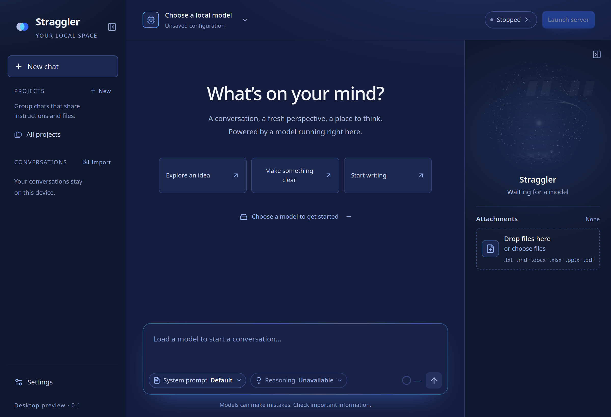
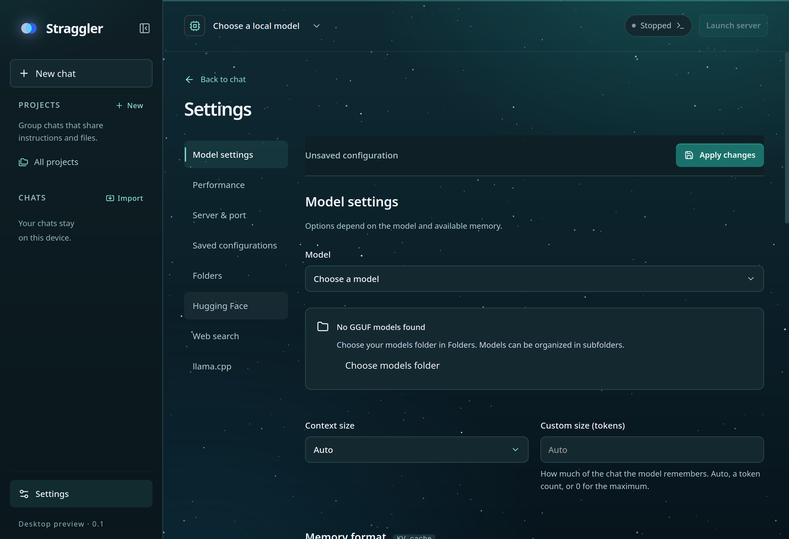

<p align="center">
  
</p>

# Straggler

Chat with local GGUF models on Linux and macOS. Straggler starts and stops
llama.cpp for you and keeps your conversations, files and model settings on your
computer. Projects let you share instructions and documents across chats.

Straggler is written for humans to read, maintain, and improve.

[](straggler/docs/screenshots/desktop-chat.png)

## Availability and requirements

**No desktop release has been published yet.** You can run the current app from
source using the commands below. Desktop packages are being prepared as a macOS
disk image and an Ubuntu Debian package, with a pinned llama.cpp backend included.
The older v1.0.0 terminal release does not install this desktop app.

To chat, you need:

- macOS 13.5+ or Ubuntu 24.04+ with a graphical session, on ARM64 or x86_64.
- A local GGUF model supported by your selected llama.cpp backend and enough
  memory to load it. Model files are supplied separately.
- Any GPU drivers required by your backend. The bundled Ubuntu backend is CPU-only;
  the regular desktop also accepts an existing external build with GPU support.

Once packages are available, drag Straggler from the macOS disk image to
Applications, or install the Ubuntu `.deb` with your package manager. Open
**Straggler** from Applications or the desktop application menu. Packaged startup
needs no Bash, Python, Node.js or Rust toolchain.

## Run from source

Install Node.js 22.13+, 24 or 26+, Rust 1.92+ and the platform's
[Tauri development prerequisites](https://v2.tauri.app/start/prerequisites/).
From the repository root, run:

```bash
npm --prefix straggler/desktop ci
npm --prefix straggler/desktop run desktop
```

The second command opens the native app; use it again for subsequent sessions.
Source development has no bundled backend: in **Settings → llama.cpp**, select an
existing llama.cpp folder containing `build/bin/llama-server` or `bin/llama-server`.
You can open and develop the app without model weights or an inference service.

## First launch

1. In **Settings → Folders**, use **Choose existing folder** for your GGUF files,
   or **Create models folder** to create storage in the app data directory. The
   **Models → Hugging Face** tab can search and download GGUFs on your request;
   a token is optional and stays in the system keychain.
2. In **Model settings**, choose a model and review the settings. Select **Apply
   changes**, then **Back to chat**.
3. Select **Launch server** and wait for **Ready**, then send a message.
4. To reuse these settings, save them in **Settings → Saved configurations**.

The model selector and server controls stay at the top of chat. **Stop response**
keeps the text received so far; **Stop server** shuts down llama.cpp. Closing the
app asks you to confirm saving and server shutdown. On a new chat, **Temporary**
(or Ctrl/⌘+Shift+N) keeps messages and attachments in memory until you choose
**Save chat**; leaving asks before erasing them.

[](straggler/docs/screenshots/desktop-settings.png)

See the [user and developer guide](straggler/docs/guide.md) for chat, files,
projects, settings, backups, troubleshooting, development and packaging.
